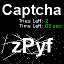
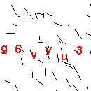
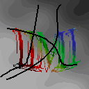
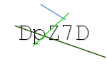
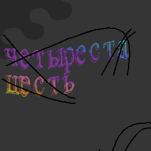
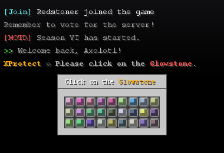
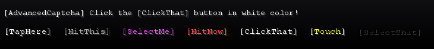
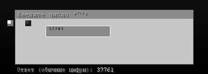
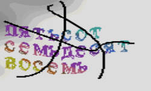

# CaptchaOCR — модель для распознования и датасет Minecraft-антибот каптч 

**Открытый датасет из 46 типов капч (23 000 размеченных PNG) плюс измерения OCR-моделей на нём —
и опубликованная на Hugging Face модель с настоящими весами.**
Лабораторная работа по машинному зрению: Java 21 (генераторы) и Python (модели).

> **Коротко:** 46 типов капч × **500 картинок** = **23 000** размеченных PNG; модель **выпущена** —
> на Hugging Face лежат **настоящие веса** (8 файлов, 77 МБ). Точность: **65.1 %** median /
> **50.2 %** micro по всем 46 типам и 23 000 картинкам; **63.8 %** median на 7 типах из
> невиданных плагинов.

В Minecraft плагины-антиботы показывают игроку картинку с кодом и просят ввести этот код в чат,
чтобы отсечь ботов. Такие картинки называют **капчами** (captcha); открытых Minecraft-плагинов,
которые их рисуют, десятки, и каждый рисует по-своему: свой шрифт, размер холста, линии-помехи,
свои ошибки. Готовые модели распознавания текста на них работают плохо — это замерено здесь.

На Java 21 написаны генераторы, которые заново отрисовывают капчи тех же открытых плагинов —
пиксель в пиксель, с теми же шрифтами, искажениями и даже **ошибками** оригинала. Каждый тип
снабжён разметкой: что нарисовано, что игрок должен ввести, где лежит полоса с ответом.

## Как выглядят эти капчи

Фрагменты из витрины — по одному примеру на стиль. Подпись под картинкой: **тип**, размер холста,
описание и **золотой ответ** — то, что игрок должен ввести.

| | | |
|---|---|---|
|  |  |  |
| `haq/mapcha/map` — 128×128, карта Minecraft, латинский код из 4 символов · ответ `zPyf` | `LagBug/XProtect/code` — 130×130, белый фон, чёрные помехи, латиница · ответ `g5vyu3` | `LimboFilter/symbols` — 128×128, тёмный фон, кириллица, 3 символа · ответ `ШМШ` |
|  |  |  |
| `GalleryCaptcha/ru-web` — 150×90, «веб-капча»: белый фон, тонкие линии · ответ `DdtOv` | `LimboFilter/framed2x2` — 256×256, пазл-рамка 2×2, число записано словами · ответ `406` | `LagBug/XProtect/gui` — 390×260, GUI-сцена: чат и инвентарь · ответ `Purpur Block` |
|  |  |  |
| `FeelingAlive0/AdvancedCaptcha/button` — 730×84, чат-сцена с кнопками · ответ `[PressThis] in pink color` | `n1zamu/NCaptcha/anvil` — 420×150, GUI наковальни, цифры · ответ `37761` | `GalleryCaptcha/ru-numberword` — 250×150, кириллица, число записано числительными · ответ `578` |

Полная витрина — по 5 картинок на каждый из 46 типов — в
[`dataset/samples/index.html`](dataset/samples/index.html).

> Витрина `dataset/samples/` — выдержка 5 картинок на тип из **текущего** рендера (500 на тип,
> 22.10.2026); полный набор — на Hugging Face.

---

## Что внутри

| | |
|---|---|
| Типов капчи | **46** — 34 в `dataset/out/`, 12 в `dataset/out_ru/` |
| Размеченных PNG | **23 000** — ровно по **500** на тип |
| Разметка | **46** файлов `labels.jsonl`, по **500** строк в каждом |
| Плагинов-источников | **23** открытых Minecraft-плагина |
| В этом репозитории | генераторы (Java), чекеры меток, обучение, измерения, веб-демо |
| Полный датасет | на Hugging Face (ссылка ниже) |

**Раскладка на диске** (контракт датасета — `agents/INDEX.md` §3):

```
dataset/out/<owner>/<repo>/<type>/NNN.png  + labels.jsonl     # 34 типа, owner/repo из апстрима
dataset/out_ru/<Plugin>/<type>/NNN.png     + labels.jsonl     # 12 типов, плоское имя плагина
```

`labels.jsonl` — одна строка JSON на сэмпл: `file`, `plugin`, `captcha`, `answer` (что вводит игрок),
`text` (что **нарисовано**; в 9 типах из 46 они различаются — нужен шаг solver'а), `prompt`,
`roi` (полоса `[x,y,w,h]` с ответом или `null`), `width`, `height`, `source` (аудит апстрима).
**Правило полосы: полоса, которая не помещается в кадр, — это не полоса** (`roi` = `null`).

**Режимы реконструкции** — по 23 плагинам-источникам: **25** типов `faithful` · **16** `clean-room` ·
**5** `reconstructed` (по плагинам: 12 / 10 / 1). Подробно — [`docs/PLUGINS.md`](docs/PLUGINS.md).

**Эталонные скриншоты** `dataset/out_ru/*/real_shots/` — **517** файлов, чужие скриншоты апстримов.
Они лежат только на диске: **в публичный репозиторий и в датасет на Hugging Face они не идут**
(на сервере — 0 таких путей, проверено при публикации).

> **Датасет — артефакт машины, а не функция.** Генераторы **не засеяны**: шрифты AWT те же, а сами
> сэмплы, текст и шум — новые при каждой пересборке. «Пересобрать и получить то же самое» здесь
> неверно; измерение всегда ведётся на конкретной папке.

## Опубликовано на Hugging Face

| что | где | что внутри |
|---|---|---|
| **Датасет** | <https://huggingface.co/datasets/Titlehhhh/captchaocr-dataset> | 23 000 PNG + 46 `labels.jsonl`, коммит `6248c5b9b6ce7eb6e917efd7aa3952892beb7cea` |
| **Модель (с весами)** | <https://huggingface.co/Titlehhhh/captchaocr-ppocrv6> | 8 файлов, 77 085 348 Б (`model.safetensors` — 76 747 448 Б), коммит `43a65582a9171ae5fb8cf2dd688c0bd4340bca0c` |

Датасет выложен **48 коммитами поверх старой публикации** (всего 80 коммитов, история не
переписана), каждый удалённый PNG сверен по **sha256** с локальным — расхождений 0.
Отчёт о публикации — [`reports/HF_DATASET_UPLOAD.md`](reports/HF_DATASET_UPLOAD.md),
загрузчик с проверкой — [`tools/upload_dataset.py`](tools/upload_dataset.py) (`--verify`).

### Модель: что именно опубликовано

**PP-OCRv6_medium_rec + интерполяция весов (WiSE-FT, α = 0.4)**:

```
θ = 0.4 · θ_дообученной  +  0.6 · θ_предобученной
```

`θ_дообученной` — наш чекпоинт (эпоха 7 из 20, шаг 1632), `θ_предобученной` —
`PaddlePaddle/PP-OCRv6_medium_rec_safetensors` (Apache-2.0, 19 134 326 параметров).

Измерено на **7 удержанных типах из 5 плагинов, 3 500 картинок** (один и тот же пайплайн:
кроп по полосе, нормализация paddle, жадный CTC-декод):

| вариант | median exact | median CER | micro exact | micro CER |
|---|---|---|---|---|
| предобученная база (нулевой шаг) | 0.588 (58.8 %) | 0.1657 | 0.5646 (56.5 %) | 0.2446 |
| дообученная как есть | **0.480** (48.0 %) | 0.2233 | 0.5480 (54.8 %) | 0.2181 |
| **+ интерполяция α = 0.4 (это опубликовано)** | **0.638** (63.8 %) | 0.1503 | **0.6123** (61.2 %) | 0.2004 |

Источник: `reports/TRAINING_PPOCR_V6_BIG.md` §5–§6, `train/run_ppocr/big/soup.json`.
Тот же замер **опубликованных** весов по всему датасету — 46 типов / 23 000 картинок:
**median 0.651 (65.1 %)**, **micro 0.502 (50.2 %)** (`reports/model_scoreboard.json`).

> **Честно, без прикрас:** чистое дообучение **на 10.8 п.п. хуже базы** (0.480 = 48.0 % против
> 0.588 = 58.8 %) — модель забывает предобучение. Именно поэтому публикуется **не** `best.pt`,
> а интерполяция с базой.
>
> **И α, и эпоху выбирали на том же удержанном наборе, на котором потом измеряли** → 0.638 / 0.6123
> (63.8 % / 61.2 %) — **оптимистичная** оценка. На втором удержанном наборе выбор α не проверялся.
> Смягчает то, что кривая гладкая: прирост есть на всём диапазоне α ∈ [0.25, 0.6], а не в одной точке.

## Наша собственная модель (CRNN+CTC с нуля)

Обучали 7 типов, удержали 4 типа из 4 невиданных плагинов (1 999 картинок):

| измерение | значение |
|---|---|
| на **7 типах, на которых учили** | **1.000** (100 %) exact, CER 0.000 — полное запоминание |
| на **4 невиданных типах**: медиана | **0.372** (37.2 %) exact, CER 0.322 |
| на **4 невиданных типах**: micro | **0.381** (38.1 %) exact, CER 0.410 |
| разрыв «обученные ↔ невиданные» | **62.8 п.п.** — модель по-прежнему запоминает |

Источник: `reports/TRAINING_CRNN_BIG.md` §5, `reports/TRAINING_CRNN_BIG.json`.
На старом рендере (100 картинок на тип) на невиданных типах было **0.000** — улучшение реальное,
но вызвано сразу четырьмя изменениями (рендер, объём, сплит, learning rate), а не одним фактором.

## Как обучить, остановить, продолжить и опубликовать

Полный runbook — **[`docs/HOW_TO_TRAIN.md`](docs/HOW_TO_TRAIN.md)**. Рецепт публикации — **три шага**:

```powershell
# 0) окно: JAVA_HOME для javac, HF_HOME для токена, .venv-gpu — единственный интерпретатор с CUDA
$env:PYTHONIOENCODING="utf-8"
$env:HF_HOME="C:\Users\Title\Projects\CapthaModel\.hf-cache"

# 1) дообучить с мягким lr=1e-5  →  train\run_ppocr\<прогон>\best.pt
.venv-gpu\Scripts\python.exe train\finetune_ppocr.py --out train\run_ppocr\big `
    --epochs 20 --batch-size 32 --lr 1e-5 --head-lr 1e-5 `
    --workers 6 --eval-every 1 --save-every 100 --max-minutes 36

# 2) интерполяция весов с базой (WiSE-FT, α = 0.4)  →  soup_best.pt + soup.json
.venv-gpu\Scripts\python.exe train\soup_eval.py

# 3) экспорт + выкладка на Hugging Face
.venv-gpu\Scripts\python.exe train\export_ppocr_hf.py --ckpt train\run_ppocr\big\soup_best.pt `
    --out train\run_ppocr\big\export
hf upload Titlehhhh/captchaocr-ppocrv6 train\run_ppocr\big\export --repo-type model
```

**Остановка:** `--max-minutes N` (мягкая: скрипт доходит до конца эпохи и пишет `ckpt\final.pt`)
или Ctrl+C. **Продолжение:** та же команда + `--resume` — восстанавливаются модель, оптимизатор,
scheduler, GradScaler и номер шага, так что это точное продолжение, а не «начать заново».
**Оценка без обучения:** `--zero-step` (нулевой шаг: мераем предобученную модель и выходим).
Подробности, флаги и разбор типичных ошибок — `docs/HOW_TO_TRAIN.md`.

> **Никогда не публикуем чистое дообучение** (`--soup-alpha` без 0.4 / `best.pt` напрямую) —
> это на 10.8 п.п. хуже базы.

## Браузерная демка

Локальный офлайн-сервер: закидываешь PNG капчи в браузер — получаешь предсказание модели,
с точностью по символам, золотым ответом и задержкой.

```powershell
.venv-gpu\Scripts\python.exe webapp\app.py      # затем откройте http://127.0.0.1:8765/
```

Сервер — только стандартная библиотека Python, веса читаются с диска, внешних ссылок на странице
нет. Подробности — [`webapp/README.md`](webapp/README.md), отчёт — [`reports/WEBAPP.md`](reports/WEBAPP.md).

## Что измерено — главный вывод

**Решает кроппер, а не модель.** На 29 типах, у которых есть полоса с ответом, одна и та же
PP-OCRv6_medium_rec даёт **0.5517** (55.2 %) exact match по полосе и **0.0345** (3.5 %) по целому
кадру — **в 16 раз хуже**. На всех 46 типах: 0.4043 (40.4 %) по полосе против 0.0783 (7.8 %) по кадру.

| что подаём на вход | micro exact (29 типов с полосой) | медиана по типам |
|---|---|---|
| полоса `roi` | **0.5517** (55.2 %) | 0.75 (75.0 %) |
| целый кадр | **0.0345** (3.5 %) | 0.00 (0.0 %) |

Источник: `reports/bench_models/ppocrv6-medium.json` (архивный замер на старом рендере,
46 типов × 20 картинок). Вывод: **кроппер — первоочередная задача**, она даёт ×16 к точности
и не требует GPU.

### Единый протокол: 12 чужих моделей на наших данных

Протокол один для всех: 20 картинок на тип, 46 типов = 920 сэмплов, метрики — exact match и CER,
нормализация «буквы/цифры любого алфавита + `+-*/=`», агрегаты — micro по сэмплам и медиана по типам.

| модель | лицензия | по полосе, 29 типов | по кадру, 29 типов | по полосе, 46 типов | медиана по типам |
|---|---|---|---|---|---|
| **PP-OCRv6_medium_rec** (ONNX) | Apache-2.0 | **0.5517** (55.2 %) | 0.0345 | **0.4043** | 0.175 |
| cyrillic_PP-OCRv5_mobile_rec (ONNX) | Apache-2.0 | 0.4621 (46.2 %) | 0.0155 | 0.3217 | 0.075 |
| PP-OCRv5_mobile_rec (ONNX) | Apache-2.0 | 0.4621 (46.2 %) | 0.0069 | 0.3152 | 0.025 |
| anuashok/ocr-captcha-v3 (TrOCR) | Apache-2.0 | 0.2966 (29.7 %) | 0.0155 | 0.2098 | 0.00 |
| graycat660/doctr-crnn-vgg16-bn-russian (ONNX) | Apache-2.0 | 0.2776 (27.8 %) | 0.0052 | 0.1804 | 0.00 |
| Graf-J/captcha-crnn-base | MIT | 0.0828 (8.3 %) | 0.0034 | 0.0533 | 0.00 |
| Graf-J/captcha-crnn-finetuned | MIT | 0.0672 (6.7 %) | 0.00 | 0.0446 | 0.00 |
| Graf-J/captcha-conv-transformer-finetuned | MIT | 0.0638 (6.4 %) | 0.0034 | 0.0402 | 0.00 |
| emelnov/ocr-captcha-v4-mailru (TrOCR) | MIT | 0.0431 (4.3 %) | 0.00 | 0.0304 | 0.00 |
| jtrecenti/txtcaptcha-crnn | MIT | 0.0034 (0.3 %) | 0.00 | 0.0022 | 0.00 |
| easyocr | Apache-2.0 | замер только по старому протоколу (8 типов, 64 сэмпла): 0.3281 micro, 0.1875 медиана — с остальными не сравнимо | | | |
| microsoft/trocr-base-printed | MIT | замер не удался: харнесс упал с `ValueError: You need to specify either 'text' or 'text_target'` | | | |

Источник каждой строки — `reports/bench_models/<имя>.json`. **Медиана по типам у всех, кроме
PP-OCRv6, равна нулю**: микро-числа показывают, что модель угадывает на «простых» типах, но не
умеет вообще — то есть не является распознавателем.

TrOCR-small-printed (обученный на тех же 7 типах) — **не лучше**: нулевой шаг median 0.00,
в 5 раз медленнее PP-OCRv6 (`reports/TRAINING_TROCR_BIG.md`).

## Карта репозитория

| путь | что внутри |
|---|---|
| `dataset/generator/`, `dataset/generator_ru/` | Java 21-генераторы 23 плагинов; правила — [`dataset/generator/AGENTS.md`](dataset/generator/AGENTS.md) |
| `dataset/out/`, `dataset/out_ru/` | сгенерированный датасет: 46 типов × 500 PNG + `labels.jsonl` |
| `dataset/samples/` | витрина: 230 PNG + `dataset/samples/index.html` (выдержка из текущего рендера) |
| `train/` | CRNN+CTC с нуля, дообучение PP-OCRv6, интерполяция весов, экспорт в HF |
| `bench/` | харнессы для чужих моделей, единый протокол [`bench/bench_models.py`](bench/bench_models.py) |
| `tools/` | чекеры меток и полос, загрузка датасета и модели на HF |
| `webapp/` | локальная браузерная демка ([`webapp/app.py`](webapp/app.py)) |
| `reports/` | измеренные результаты: индекс — [`reports/README.md`](reports/README.md), отчёт — [`reports/HTML/index.html`](reports/HTML/index.html), старое — `reports/archive/` |
| `docs/` | онбординг, глоссарий, ADR, runbook, конвейер |
| `agents/` | карта репозитория, журнал сессий, правила оркестратора |
| `research/` | апстримы, декомпиляция, эталоны, исходники рантайма |

## Лицензии

Код репозитория — MIT ([`LICENSE`](LICENSE)). **Картинки датасета** — не MIT: они подчиняются
лицензиям соответствующих плагинов-источников. Расклад по 23 источникам
(по типам: 25 faithful · 16 clean-room · 5 reconstructed):

| лицензия | плагины | режим |
|---|---|---|
| MIT (11) | `LagBug/XProtect`, `FeelingAlive0/AdvancedCaptcha`, `Z4OLLIEZ4/reCaptcha`, `Joey61021/captcha`, `laforetbrut/are-you-sure`, `Mrbysco/Captcha`, `InstantlyMoist/Captcha`, `JSH32/Minecaptcha`, `haq/mapcha`, `just-captcha/ProstoCaptcha`, `n1zamu/NCaptcha` | faithful |
| GPL-3.0 (3) | `jonesdevelopment/sonar`, `China2B2T/Captcha`, `irootdev/AnBot` | clean-room |
| AGPL-3.0 (1) | `Elytrium/LimboFilter` | clean-room |
| CC0-1.0 (1) | `jSdCool/minecaptcha` | faithful |
| BSD с оговоркой (1) | `BotFilter` | clean-room |
| не указана (2) | `CaptchaGUI`, `CaptchaVerifyZ` | clean-room |
| лицензии нет (3) | `Archy-X/Krypton`, `Yukun99/Captchas`, `ringoame196-s-mcPlugin/ReproductionCAPTCHA` | clean-room |
| — (1 группа) | `GalleryCaptcha/*` | reconstructed |

Построчная таблица с платформой, ссылками и типами — [`docs/PLUGINS.md`](docs/PLUGINS.md);
что покрыто MIT, а что лицензией апстрима — [`docs/LICENSES.md`](docs/LICENSES.md).
Дефекты апстрима воспроизводятся, а не чинятся — [`docs/UPSTREAM_DEFECTS.md`](docs/UPSTREAM_DEFECTS.md).

## Куда смотреть

| Хочу | Файл |
|---|---|
| **Прочитать один отчёт со всеми числами** | **[`reports/HTML/index.html`](reports/HTML/index.html)** — 46 типов картинками, таблица моделей, замеры, runbook |
| Индекс всех отчётов | [`reports/README.md`](reports/README.md) |
| Обзор ландшафта OCR/VLM/CTC-моделей | [`docs/OCR_MODELS_101.md`](docs/OCR_MODELS_101.md) |
| Как PNG доходит до модели (кроп, полоса, нормализация) | [`docs/INPUT_PIPELINE.md`](docs/INPUT_PIPELINE.md) |
| Как обучить и опубликовать | [`docs/HOW_TO_TRAIN.md`](docs/HOW_TO_TRAIN.md) |
| Окружение этой машины (JDK, HF-токен, venv) | [`docs/LOCAL_ENV.md`](docs/LOCAL_ENV.md) |
| Подробная карта репозитория для машины | [`agents/INDEX.md`](agents/INDEX.md) |
| Маршрут с нуля: посмотреть → обучить → добавить тип → проверить | [`docs/ONBOARDING.md`](docs/ONBOARDING.md) |
| Скачать датасет | [`tools/fetch_dataset.py`](tools/fetch_dataset.py) · [`reports/HF_DATASET_UPLOAD.md`](reports/HF_DATASET_UPLOAD.md) |
| Плагины, лицензии, режимы реконструкции | [`docs/PLUGINS.md`](docs/PLUGINS.md) · [`docs/LICENSES.md`](docs/LICENSES.md) |
| Контракт `labels.jsonl` и правило полосы | [`docs/DATASET_FORMAT.md`](docs/DATASET_FORMAT.md) |
| Добавить свой тип капчи | [`dataset/generator/AGENTS.md`](dataset/generator/AGENTS.md) |
| Измерения: JSON-протоколы и их разбор | [`reports/bench_models/`](reports/bench_models/) |

Статьи: CRNN — [arXiv:1507.05717](https://arxiv.org/abs/1507.05717) · PP-OCRv6 —
[arXiv:2606.13108](https://arxiv.org/abs/2606.13108) · SVTRv2 —
[arXiv:2411.15858](https://arxiv.org/abs/2411.15858)
