# CaptchaOCR — модель для распознавания и датасет Minecraft-антибот капч

**Открытый датасет из 20 типов капч (200 000 размеченных PNG) плюс измерения OCR-моделей на нём —
и опубликованная на Hugging Face модель с настоящими весами.**
Лабораторная работа по машинному зрению: Java 21 (генераторы) и Python (модели).

На диске сейчас 21 тип × 10 000 = 210 000 PNG (добавлен тип `LimboFilter/digits`, он ещё не опубликован на Hugging Face).

> **Коротко:** 20 типов капч × **10 000 картинок** = **200 000** размеченных PNG — 12 типов
> в `dataset/out/`, 8 в `dataset/out_ru/`. На Hugging Face датасет лежит **9 Parquet-шардами**
> (200 000 строк, 1.91 GiB). Модель **выпущена** — на Hugging Face лежат **настоящие веса**
> (8 файлов, 77 МБ). Опубликованная модель — `universal_v1`, измерена на 18 типах / 11 400 примерах: median exact **0.8875**, CER median 0.0344,
> micro exact **0.7797**, CER micro 0.0755; нулевой шаг (до дообучения): median 0.875, micro 0.6499.

В Minecraft плагины-антиботы показывают игроку картинку с кодом и просят ввести этот код в чат,
чтобы отсечь ботов. Такие картинки называют **капчами** (captcha); открытых Minecraft-плагинов,
которые их рисуют, десятки, и каждый рисует по-своему: свой шрифт, размер холста, линии-помехи,
свои ошибки. Готовые модели распознавания текста на них работают плохо — это замерено здесь.

На Java 21 написаны генераторы, которые заново отрисовывают капчи тех же открытых плагинов —
пиксель в пиксель, с теми же шрифтами, искажениями и даже **ошибками** оригинала. Каждый тип
снабжён разметкой: что нарисовано, что игрок должен ввести, где лежит полоса с ответом.

## Как выглядят эти капчи

Все 20 типов — это плоские картинки: текст нарисован на холсте, игрок читает его и вводит в чат.
Ниже по одному примеру на каждый тип. Подпись под картинкой: **тип**, размер холста, что нарисовано
и **золотой ответ** — то, что игрок должен ввести.

| картинка | тип · холст · что нарисовано · ответ |
|---|---|
| 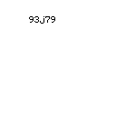 | **`Archy-X/Krypton/map`** — 128×128, карта Minecraft, мелкий тёмный код · ответ `93j79` |
|  | **`haq/mapcha/map`** — 128×128, тёмная карта: плашка «Captcha / Tries left / Time left» и код · ответ `zPyf` |
| 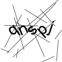 | **`InstantlyMoist/Captcha/textcaptcha`** — 128×128, белый холст, тонкие диагональные линии, латиница · ответ `qnspj` |
| 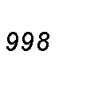 | **`irootdev/AnBot/captcha`** — 128×128, белый холст, тонкие линии, цифры · ответ `998` |
|  | **`jonesdevelopment/sonar/complex`** — 128×128, белый холст в цветной крошке, 3 символа · ответ `pkr` |
| 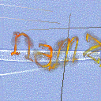 | **`jonesdevelopment/sonar/legacy`** — 128×128, сине-фиолетовый холст, «рукописные» буквы · ответ `jdhe` |
| 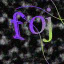 | **`jonesdevelopment/sonar/standard`** — 128×128, тёмный шумный холст, радужные буквы под дугами · ответ `beh` |
| 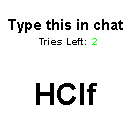 | **`JSH32/Minecaptcha/map`** — 130×130, панель «Type this in chat / Tries Left: 2» и код · ответ `HClf` |
|  | **`just-captcha/ProstoCaptcha/map`** — 128×128, тёмная панель «PROSTOCAPTCHA», код в помехах · ответ `PWw33f` |
|  | **`LagBug/XProtect/code`** — 130×130, белый холст, красный код и чёрные штрихи · ответ `g5vyu3` |
| 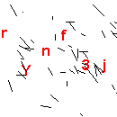 | **`LagBug/XProtect/map`** — 130×130, белый холст, красный код и чёрные линии · ответ `k1VIUF` |
| 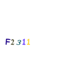 | **`ringoame196-s-mcPlugin/ReproductionCAPTCHA/map`** — 128×128, белый холст, чёрные цифры · ответ `61143` |
|  | **`BotFilter/map`** — 128×128, белый холст, крупные контурные цифры под наклоном · ответ `38920` |
| 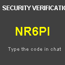 | **`CaptchaVerifyZ/map`** — 128×128, тёмная панель «SECURITY VERIFICATION», жёлтый код · ответ `NR6PI` |
|  | **`GalleryCaptcha/ru-numberword`** — 250×150, светлый холст, число записано числительными · ответ `578` |
| 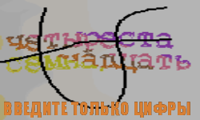 | **`GalleryCaptcha/ru-numberword-caption`** — 250×150, тёмный холст, слова и подпись «ВВЕДИТЕ ЦИФРЫ С КАРТИНКИ В ЧАТ» · ответ `384` |
| 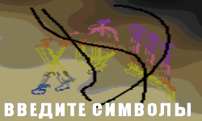 | **`GalleryCaptcha/ru-symbols`** — 250×150, светлый холст, крупные символы и подпись «ВВЕДИТЕ СИМВОЛЫ» · ответ `5МП` |
|  | **`GalleryCaptcha/ru-web`** — 150×90, градиент, латиница и подпись «ВВЕДИТЕ СИМВОЛЫ» · ответ `DdtOv` |
| 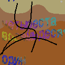 | **`LimboFilter/map`** — 128×128, светлая карта, число словами и подпись «ВВЕДИТЕ ТОЛЬКО ЦИФРЫ» · ответ `481` |
|  | **`LimboFilter/symbols`** — 128×128, тёмный холст, кириллические символы под линиями · ответ `ШМШ` |

Полная витрина — [`dataset/samples/index.html`](dataset/samples/index.html): 230 PNG, по 5 картинок
на тип.

> Витрина `dataset/samples/` — выдержка из **прежнего** рендера (22.10.2026). Она не пересобиралась
> под текущие 20 типов × 10 000 и с текущими картинками не совпадает; актуальный набор — Parquet
> на Hugging Face (раздел ниже).

---

## Что внутри

| | |
|---|---|
| Типов капчи | **20** — 12 в `dataset/out/`, 8 в `dataset/out_ru/` |
| Размеченных PNG | **200 000** — ровно по **10 000** на тип |
| Разметка | **20** файлов `labels.jsonl` (по одному на тип), суммарно **62.8 МБ** |
| Плагинов-источников | **13** открытых Minecraft-плагинов |
| Объём на диске | ≈ **2.0 ГБ** (PNG + разметка) |
| Генерация на 36 потоках | `dataset/out` — 120 000 картинок за **76.9 с** (1561 PNG/с); `dataset/out_ru` — 80 000 за **115.0 с** (695.5 PNG/с) |
| В этом репозитории | генераторы (Java), чекеры меток, обучение, измерения, веб-демо |
| Полный датасет | на Hugging Face — 9 Parquet-шардов (ссылка ниже) |

**Раскладка на диске** (контракт датасета — `agents/INDEX.md` §3):

```
dataset/out/<owner>/<repo>/<type>/NNN.png  + labels.jsonl     # 12 типов, owner/repo из апстрима
dataset/out_ru/<Plugin>/<type>/NNN.png     + labels.jsonl     # 8 типов, плоское имя плагина
```

`labels.jsonl` — одна строка JSON на сэмпл: `file`, `plugin`, `captcha`, `answer` (что вводит игрок),
`text` (что **нарисовано**), `prompt`, `roi` (полоса `[x,y,w,h]` с ответом или `null`), `width`,
`height`, `source` (аудит апстрима). В **3 типах из 20** `text` и `answer` различаются — это
`GalleryCaptcha/ru-numberword`, `GalleryCaptcha/ru-numberword-caption` и `LimboFilter/map`, где
нарисовано число словами, а ввести надо цифры (30 000 строк); в остальных 17 типах они совпадают.
**Правило полосы: полоса, которая не помещается в кадр, — это не полоса** (`roi` = `null`).

Полоса есть у **49 984** из 120 000 строк в `dataset/out` и у **70 000** из 80 000 в `dataset/out_ru`.
Обе проверки чистые: `tools/check_labels_and_roi.py` на `dataset/out` даёт 120 000 сэмплов,
49 984 с полосой, 0 расхождений меток, 0 проблем с полосой, `RESULT: OK`; на `dataset/out_ru` —
80 000 сэмплов, 70 000 с полосой, 0 расхождений, 0 проблем, `RESULT: OK`.

**Режимы реконструкции** — по 13 плагинам-источникам: **6** типов `faithful` · **10** `clean-room` ·
**4** `reconstructed` (по плагинам: 5 / 7 / 1). Подробно — [`docs/PLUGINS.md`](docs/PLUGINS.md).

**Эталонные скриншоты** `dataset/out_ru/*/real_shots/` — **523** файла, чужие скриншоты апстримов.
Они лежат только на диске: **в публичный репозиторий и в датасет на Hugging Face они не идут**.

**В git датасета нет:** PNG не отслеживались никогда (`.gitignore`), а с коммита `a358988`
не отслеживаются и `labels.jsonl` — они генерируются заново и живут на Hub внутри Parquet.
В репозитории — только код, `index.html`-витрины и документация.

> **Датасет — артефакт машины, а не функция.** Генераторы **не засеяны**: шрифты AWT те же, а сами
> сэмплы, текст и шум — новые при каждой пересборке. «Пересобрать и получить то же самое» здесь
> неверно; измерение всегда ведётся на конкретной папке.

## Опубликовано на Hugging Face

| что | где | что внутри |
|---|---|---|
| **Датасет** | <https://huggingface.co/datasets/Titlehhhh/captchaocr-dataset> | 9 Parquet-шардов, 200 000 строк, 2 047 757 145 Б (1.91 GiB), коммит `dd4d7479a95f8e4c8ea19643dfe5889fe5dea113` |
| **Модель (с весами)** | <https://huggingface.co/Titlehhhh/captchaocr-ppocrv6> | 8 файлов, **77 128 999 Б** (`model.safetensors` — 76 787 592 Б, sha256 `a65c8756b1a86174ca49e1028a3f6c8b4986886e99708c55fc4b89fc26a018ae`); коммит **весов** `27eb6fecbce4689a3550e9984d1a984f3ac9dd3a`, коммит **карточки** `37556a884d34e08173e20d55cc9c36b71d250f2e` («model card: describe universal_v1, not the previous all20 run»); **18 762 классов, без интерполяции весов; карточка обновлена 2026-10-27** |

### Датасет: Parquet-шарды

16 файлов в репозитории:

```
data/train-00000-of-00009.parquet … train-00008-of-00009.parquet   # 9 шардов, 2 047 757 145 Б
gallery/sheet_01.png  gallery/sheet_02.png  gallery/sheet_03.png    # контактные листы
README.md                         # карточка датасета
dataset_inventory.json            # машинно-читаемая сводка
LICENSE                           # разбор лицензий по плагинам
.gitattributes
```

Одна строка — один сэмпл: сырые байты PNG в `image` и все поля разметки рядом. Порядок строк
детерминирован: дерево (`out`, затем `out_ru`), тип, порядок `labels.jsonl`.

**Схема (13 колонок):**

| колонка | тип Arrow | nullable | смысл |
|---|---|---|---|
| `image` | `binary` | нет | сырые байты PNG (декодировать PIL/OpenCV) |
| `file` | `string` | нет | имя PNG внутри каталога типа (`001.png` …) |
| `type_id` | `string` | нет | путь типа, напр. `out/Archy-X/Krypton/map` или `out_ru/LimboFilter/symbols` |
| `plugin` | `string` | нет | плагин-источник |
| `captcha` | `string` | нет | тип капчи внутри плагина |
| `answer` | `string` | нет | что игрок вводит в поле ответа |
| `text` | `string` | **да** | что **нарисовано** на картинке; бывает `null` |
| `prompt` | `string` | **да** | текст задания, как его показывает плагин; бывает `null` |
| `roi` | `list<int32>` | **да** | полоса `[x, y, w, h]` или `null`, если полоса не помещается в кадр |
| `width` | `int32` | нет | ширина PNG в пикселях |
| `height` | `int32` | нет | высота PNG в пикселях |
| `source` | `string` | нет | откуда тип: класс и метод апстрима (`file#method`) |
| `tree` | `string` | нет | `out` или `out_ru` |

**Как загрузить — два пути.** Первый: `huggingface_hub` + `pyarrow` (на этой машине стоят оба —
`pyarrow 26.0.0`, `huggingface_hub 1.33.0`):

```python
from huggingface_hub import snapshot_download
import io
import pyarrow.parquet as pq
from PIL import Image

root = snapshot_download("Titlehhhh/captchaocr-dataset", repo_type="dataset",
                         allow_patterns=["data/*.parquet"])
table = pq.read_table(f"{root}/data")          # все 9 шардов
row = table.slice(0, 1).to_pylist()[0]
img = Image.open(io.BytesIO(row["image"]))     # image — сырые байты PNG
print(row["type_id"], row["answer"], img.size)

# без декодирования картинок: проекция колонок и фильтр по типу
answers = pq.read_table(f"{root}/data", columns=["type_id", "answer"])
map_rows = pq.read_table(f"{root}/data", filters=[("type_id", "=", "out/haq/mapcha/map")])
```

Второй путь — библиотека `datasets` (читает те же Parquet-шарды, без loading script). **Честно:**
на этой машине `datasets` **не установлена**, поэтому `load_dataset(...)` здесь **ни разу не
запускался**; код ниже — документированный путь, а не выполненный замер:

```python
# import datasets
# from datasets import load_dataset
# ds = load_dataset("Titlehhhh/captchaocr-dataset", split="train")
# ds = ds.cast_column("image", datasets.Image())   # иначе image останется bytes
```

**Оговорка про `image`.** Это обычная `binary`-колонка, а **не** HF-фича `Image`. Загрузчик вернёт
`bytes`, которые надо декодировать самому — `PIL.Image.open(io.BytesIO(b))` — либо привести колонку
через `cast_column("image", datasets.Image())`. Иначе `row["image"]` — не картинка, а blob.

Прежнее дерево поштучных PNG (`data/out/**`, `data/out_ru/**`, **30 546** путей) с Hub **удалено**:
датасет живёт только в Parquet, а значения меток при переезде не менялись. Отчёт о прежней
(loose-PNG) публикации — [`reports/HF_DATASET_UPLOAD.md`](reports/HF_DATASET_UPLOAD.md).

### Модель: что именно опубликовано

**PP-OCRv6_medium_rec, дообученная без интерполяции весов** (публикуется сам чекпоинт):

```
θ = 1.0 · θ_дообученной  +  0.0 · θ_предобученной
```

`θ_дообученной` — наш чекпоинт `train/runs/ppocrv6/universal_v1/best.pt` (5 эпох, 2 440 шагов,
CTC-голова расширена до **18 762 классов**: предобученная голова сохранена, добавлена кириллица),
`θ_предобученной` — `PaddlePaddle/PP-OCRv6_medium_rec_safetensors` (Apache-2.0, 19 134 326 параметров).

Измерено на **18 типах / 11 400 примерах** (6 удержанных типов + 12 остальных; один и тот же
пайплайн: кроп по полосе, нормализация paddle, жадный CTC-декод):

| вариант | median exact | median CER | micro exact | micro CER |
|---|---|---|---|---|
| предобученная база (нулевой шаг) | 0.875 | — | 0.6499 | — |
| **опубликованные веса `universal_v1`** | **0.8875** | **0.0344** | **0.7797** | **0.0755** |

Источник: `train/runs/ppocrv6/universal_v1/result.json`, карточка — `train/MODEL_CARD.md`.
Прежний замер **прежней** публикации (интерполяция весов с базой) по всему прежнему датасету:
**median 0.651 (65.1 %)**, **micro 0.502 (50.2 %)** (`reports/model_scoreboard.json`).

> **Честно, без прикрас:** на прежнем 7-типовом наборе (3 500 картинок) чистое дообучение было
> **на 10.8 п.п. хуже базы** (0.480 = 48.0 % против 0.588 = 58.8 %) — тогда публиковалась
> интерполяция с базой (median 0.638). Сейчас правило другое: интерполяция на **расширенной**
> CTC-голове разрушает добавленные кириллические классы, поэтому публикуется чистый чекпоинт
> (`--soup-alpha 1.0`).
>
> Числа прежнего эксперимента — **исторические**: они сняты на прежнем датасете и на прежнем
> наборе из 7 удержанных типов, где и α, и эпоху выбирали на тех же данных, на которых потом
> мерили (0.638 / 0.6123 — **оптимистичная** оценка). К текущей публикации они не относятся.

## Наша собственная модель (CRNN+CTC с нуля)

Обучали 7 типов, удержали 4 типа из 4 невиданных плагинов (1 999 картинок):

| измерение | значение |
|---|---|
| на **7 типах, на которых учили** | **1.000** (100 %) exact, CER 0.000 — полное запоминание |
| на **4 невиданных типах**: медиана | **0.372** (37.2 %) exact, CER 0.322 |
| на **4 невиданных типах**: micro | **0.381** (38.1 %) exact, CER 0.410 |
| разрыв «обученные ↔ невиданные» | **62.8 п.п.** — модель по-прежнему запоминает |

Источник: `reports/TRAINING_CRNN_BIG.md` §5, `reports/TRAINING_CRNN_BIG.json`.
На старом рендере (100 картинок на тип) на невиданных типах было **0.000** — улучшение реальное,
но вызвано сразу четырьмя изменениями (рендер, объём, сплит, learning rate), а не одним фактором.

## Как обучить, остановить, продолжить и опубликовать

Полный runbook — **[`docs/HOW_TO_TRAIN.md`](docs/HOW_TO_TRAIN.md)**. Все команды — **из корня
репозитория** (каталог, где лежат `AGENTS.md` и `dataset/`).

Токен Hugging Face лежит в `$env:HF_HOME\token` (поэтому `HF_HOME` указывает на `.hf-cache`), а
снапшоты моделей — в `$env:HF_HOME\hub` (поэтому `HF_HUB_CACHE` указывает на подпапку `hub`).
Токена у вас ещё нет? Создайте каталог `.hf-cache` в корне репозитория и положите туда свой токен
(`hf auth login` кладёт его в `%USERPROFILE%\.cache\huggingface\token`; скопируйте его в
`.hf-cache\token`) либо задайте `HF_HOME` на свой общий кэш. **Токен не печатать и не коммитить.**

```powershell
# 0) окно: JAVA_HOME для javac, HF_HOME для токена, .venv-gpu — единственный интерпретатор с CUDA
$env:PYTHONIOENCODING="utf-8"

# из корня репозитория: токен в $HF_HOME\token, снапшоты моделей — в $HF_HOME\hub
$env:HF_HOME      = (Resolve-Path .\.hf-cache).Path
$env:HF_HUB_CACHE = Join-Path $env:HF_HOME "hub"

# 1) дообучить модель (рецепт прогона universal_v1)  →  train\runs\ppocrv6\universal_v1\best.pt
.venv-gpu\Scripts\python.exe train\finetune_ppocr.py --out train\runs\ppocrv6\universal_v1 `
    --init-from train\runs\ppocrv6\limbo_cyr3\best.pt --expand-charset --train-frames `
    --epochs 5 --batch-size 32 --lr 8e-6 --head-lr 8e-6 --workers 0 --seed 42 `
    --limit-per-type 1500 --holdout-per-type 200 --eval-every 5 --save-every 400 --max-minutes 60 `
    --val-types out/jonesdevelopment/sonar/standard out/jonesdevelopment/sonar/legacy out/jonesdevelopment/sonar/complex out_ru/BotFilter/map out_ru/CaptchaVerifyZ/map out/laforetbrut/are-you-sure/code out/JSH32/Minecaptcha/map `
    --exclude-types ru-numberword ru-numberword-caption LimboFilter/map

# 2) экспорт чекпоинта БЕЗ интерполяции весов (--soup-alpha 1.0 = сам чекпоинт)
.venv-gpu\Scripts\python.exe train\export_ppocr_hf.py `
    --ckpt train\runs\ppocrv6\universal_v1\best.pt --soup-alpha 1.0 `
    --out train\runs\ppocrv6\universal_v1\export_hf

# 3) публикация: ТОЛЬКО экспорт текущего прогона
hf upload Titlehhhh/captchaocr-ppocrv6 train\runs\ppocrv6\universal_v1\export_hf --repo-type model

# 4) датасет: PNG → Parquet-шарды → выкладка (и удаление старого loose-дерева на Hub)
.venv-gpu\Scripts\python.exe tools\export_parquet.py --dry-run
.venv-gpu\Scripts\python.exe tools\export_parquet.py --out build\parquet
.venv-gpu\Scripts\python.exe tools\export_parquet.py --out build\parquet --upload
.venv-gpu\Scripts\python.exe tools\export_parquet.py --out build\parquet --verify
```

> **Публиковать можно только экспорт текущего прогона.** Загружать надлежит лишь папку
> `train\runs\ppocrv6\universal_v1\export_hf` — то, что шаг 2 собрал **из этого же** чекпоинта.
> Прежние папки экспорта (прежняя схема каталогов `train\run_pp*` — там лежит экспорт с
> интерполяцией весов и со старой головой модели) при `hf upload` **перезапишут** уже
> опубликованные веса `universal_v1` более старыми.
>
> И ещё одно: у экспортёра `--soup-alpha` по умолчанию **0.4**, то есть интерполяция с базой.
> Для текущей модели (голова расширена кириллицей) это нужно отключать явно —
> `--soup-alpha 1.0`, как в шаге 2.

`tools/export_parquet.py` — **три режима**: `--dry-run` (план: сэмплы, шарды, байты, разбивка
по деревьям; ничего не пишется), `--upload` (шарды в `data/`, карточка в корень, затем удаление
старого дерева `data/out/**` и `data/out_ru/**` пачками по 1000 путей), `--verify` (перечислить
удалённое дерево и проверить, что остались только Parquet-шарды; расхождение — ненулевой код
возврата). Собирать шарды умеет один `pyarrow` — `datasets` не нужна.

`tools/upload_dataset.py` — прежний загрузчик **поштучных** PNG; у него три новых флага: `--prune`
(удалить устаревшие пути в репозитории), `--batch-files N` (резать загрузку на коммиты не больше
N файлов, по умолчанию 250 — десять тысяч PNG одного типа больше не превращаются в один
стомегабайтный коммит), `--num-threads N` (сколько LFS-потоков отдаётся коммиту, по умолчанию 16).
Штатная публикация датасета теперь идёт через `export_parquet.py`; загрузчик оставлен для работы
с поштучным деревом.

> **Старый рецепт устарел.** `hf upload` поштучных PNG и `labels.jsonl` из `dataset/out` /
> `dataset/out_ru` больше не работает: этого дерева на Hub нет (30 546 путей удалено), датасет
> отдаётся только Parquet-шардами. Для публикации датасета используйте `export_parquet.py`.

**Остановка:** `--max-minutes N` (мягкая: скрипт доходит до конца эпохи и пишет `ckpt\final.pt`)
или Ctrl+C. **Продолжение:** та же команда + `--resume` — восстанавливаются модель, оптимизатор,
scheduler, GradScaler и номер шага, так что это точное продолжение, а не «начать заново».
**Оценка без обучения:** `--zero-step` (нулевой шаг: мераем предобученную модель и выходим).
Подробности, флаги и разбор типичных ошибок — `docs/HOW_TO_TRAIN.md`.

> Правило больше не действует: опубликована именно чистая дообучка (alpha = 1.0, без интерполяции),
> потому что WiSE-FT на расширенной CTC-голове разрушает добавленные кириллические классы.

## Браузерная демка

Локальный офлайн-сервер: закидываешь PNG капчи в браузер — получаешь предсказание модели,
с точностью по символам, золотым ответом и задержкой.

```powershell
.venv-gpu\Scripts\python.exe webapp\app.py      # затем откройте http://127.0.0.1:8765/
```

Сервер — только стандартная библиотека Python, веса читаются с диска, внешних ссылок на странице
нет. Подробности — [`webapp/README.md`](webapp/README.md), отчёт — [`reports/WEBAPP.md`](reports/WEBAPP.md).

## Что измерено — главный вывод

> **Оговорка об актуальности.** Все числа в этом разделе и ниже — включая скорборд 0.651 / 0.502
> и таблицу 12 чужих моделей — сняты на **прежнем** датасете (46 типов × 500 = 23 000 картинок)
> и на текущем (20 типов, 200 000 PNG) **не перепроверялись**. Это исторические измерения;
> свойствами текущего датасета они не являются.

**Решает кроппер, а не модель.** На 29 типах, у которых есть полоса с ответом, одна и та же
PP-OCRv6_medium_rec даёт **0.5517** (55.2 %) exact match по полосе и **0.0345** (3.5 %) по целому
кадру — **в 16 раз хуже**. На всех типах прежнего датасета: 0.4043 (40.4 %) по полосе против
0.0783 (7.8 %) по кадру.

Актуальный замер кроппера от 2026-10-27 (через код приложения, 21 тип × 40 сэмплов = 840):
oracle 69 %, кроппер **62 %**, весь кадр **44 %**; на шести реальных скриншотах владельца
кроппер даёт **6/6**.

| что подаём на вход | micro exact (29 типов с полосой) | медиана по типам |
|---|---|---|
| полоса `roi` | **0.5517** (55.2 %) | 0.75 (75.0 %) |
| целый кадр | **0.0345** (3.5 %) | 0.00 (0.0 %) |

Источник: `reports/bench_models/ppocrv6-medium.json` (архивный замер на старом рендере,
по 20 картинок на тип). Вывод: **кроппер — первоочередная задача**, она даёт ×16 к точности
и не требует GPU.

### Единый протокол: 12 чужих моделей на наших данных

Протокол один для всех: 20 картинок на тип, 920 сэмплов прежнего датасета, метрики — exact match
и CER, нормализация «буквы/цифры любого алфавита + `+-*/=`», агрегаты — micro по сэмплам и медиана
по типам.

| модель | лицензия | по полосе, 29 типов | по кадру, 29 типов | по полосе, все типы | медиана по типам |
|---|---|---|---|---|---|
| **PP-OCRv6_medium_rec** (ONNX) | Apache-2.0 | **0.5517** (55.2 %) | 0.0345 | **0.4043** | 0.175 |
| cyrillic_PP-OCRv5_mobile_rec (ONNX) | Apache-2.0 | 0.4621 (46.2 %) | 0.0155 | 0.3217 | 0.075 |
| PP-OCRv5_mobile_rec (ONNX) | Apache-2.0 | 0.4621 (46.2 %) | 0.0069 | 0.3152 | 0.025 |
| anuashok/ocr-captcha-v3 (TrOCR) | Apache-2.0 | 0.2966 (29.7 %) | 0.0155 | 0.2098 | 0.00 |
| graycat660/doctr-crnn-vgg16-bn-russian (ONNX) | Apache-2.0 | 0.2776 (27.8 %) | 0.0052 | 0.1804 | 0.00 |
| Graf-J/captcha-crnn-base | MIT | 0.0828 (8.3 %) | 0.0034 | 0.0533 | 0.00 |
| Graf-J/captcha-crnn-finetuned | MIT | 0.0672 (6.7 %) | 0.00 | 0.0446 | 0.00 |
| Graf-J/captcha-conv-transformer-finetuned | MIT | 0.0638 (6.4 %) | 0.0034 | 0.0402 | 0.00 |
| emelnov/ocr-captcha-v4-mailru (TrOCR) | MIT | 0.0431 (4.3 %) | 0.00 | 0.0304 | 0.00 |
| jtrecenti/txtcaptcha-crnn | MIT | 0.0034 (0.3 %) | 0.00 | 0.0022 | 0.00 |
| easyocr | Apache-2.0 | замер только по старому протоколу (8 типов, 64 сэмпла): 0.3281 micro, 0.1875 медиана — с остальными не сравнимо | | | |
| microsoft/trocr-base-printed | MIT | замер не удался: харнесс упал с `ValueError: You need to specify either 'text' or 'text_target'` | | | |

Источник каждой строки — `reports/bench_models/<имя>.json`. **Медиана по типам у всех, кроме
PP-OCRv6, равна нулю**: микро-числа показывают, что модель угадывает на «простых» типах, но не
умеет вообще — то есть не является распознавателем.

TrOCR-small-printed (обученный на тех же 7 типах) — **не лучше**: нулевой шаг median 0.00,
в 5 раз медленнее PP-OCRv6 (`reports/TRAINING_TROCR_BIG.md`).

## Карта репозитория

| путь | что внутри |
|---|---|
| `dataset/generator/`, `dataset/generator_ru/` | Java 21-генераторы апстрим-капч (датасет строится по 13 плагинам); правила — [`dataset/generator/AGENTS.md`](dataset/generator/AGENTS.md) |
| `dataset/out/`, `dataset/out_ru/` | сгенерированный датасет: **21** тип × 10 000 PNG (20 типов опубликованы на Hugging Face) |
| `dataset/samples/` | витрина: 230 PNG + `dataset/samples/index.html` — выдержка из **прежнего** рендера |
| `train/` | CRNN+CTC с нуля, дообучение PP-OCRv6, интерполяция весов, экспорт в HF |
| `bench/` | харнессы для чужих моделей, единый протокол [`bench/bench_models.py`](bench/bench_models.py) |
| `tools/` | чекеры меток и полос, экспорт в Parquet ([`tools/export_parquet.py`](tools/export_parquet.py)), загрузка на HF |
| `webapp/` | локальная браузерная демка ([`webapp/app.py`](webapp/app.py)) |
| `reports/` | измеренные результаты: индекс — [`reports/README.md`](reports/README.md), отчёт — [`reports/HTML/index.html`](reports/HTML/index.html), старое — `reports/archive/` |
| `docs/` | онбординг, глоссарий, ADR, runbook, конвейер |
| `agents/` | карта репозитория, журнал сессий, правила оркестратора |
| `research/` | апстримы, декомпиляция, эталоны, исходники рантайма |

## Лицензии

Код репозитория — MIT ([`LICENSE`](LICENSE)). **Картинки датасета** — не MIT: они подчиняются
лицензиям соответствующих плагинов-источников. Расклад по **13** источникам
(по типам: 6 faithful · 10 clean-room · 4 reconstructed):

| лицензия | плагины | режим |
|---|---|---|
| MIT (5) | `LagBug/XProtect`, `InstantlyMoist/Captcha`, `JSH32/Minecaptcha`, `haq/mapcha`, `just-captcha/ProstoCaptcha` | faithful |
| GPL-3.0 (2) | `jonesdevelopment/sonar`, `irootdev/AnBot` | clean-room |
| AGPL-3.0 (1) | `Elytrium/LimboFilter` | clean-room |
| BSD с оговоркой (1) | `BotFilter` | clean-room |
| все права защищены (1) | `CaptchaVerifyZ` | clean-room, проверено по пикселям |
| лицензии нет (2) | `Archy-X/Krypton`, `ringoame196-s-mcPlugin/ReproductionCAPTCHA` | clean-room |
| — (1 группа) | `GalleryCaptcha/*` | reconstructed |

Построчная таблица с платформой, ссылками и типами — [`docs/PLUGINS.md`](docs/PLUGINS.md);
что покрыто MIT, а что лицензией апстрима — [`docs/LICENSES.md`](docs/LICENSES.md).
Дефекты апстрима воспроизводятся, а не чинятся — [`docs/UPSTREAM_DEFECTS.md`](docs/UPSTREAM_DEFECTS.md).

## Куда смотреть

| Хочу | Файл |
|---|---|
| **Прочитать один отчёт со всеми числами** | **[`reports/HTML/index.html`](reports/HTML/index.html)** — таблица моделей, замеры, runbook |
| Индекс всех отчётов | [`reports/README.md`](reports/README.md) |
| Обзор ландшафта OCR/VLM/CTC-моделей | [`docs/OCR_MODELS_101.md`](docs/OCR_MODELS_101.md) |
| Как PNG доходит до модели (кроп, полоса, нормализация) | [`docs/INPUT_PIPELINE.md`](docs/INPUT_PIPELINE.md) |
| Как обучить и опубликовать | [`docs/HOW_TO_TRAIN.md`](docs/HOW_TO_TRAIN.md) |
| Экспорт датасета в Parquet и публикация | [`tools/export_parquet.py`](tools/export_parquet.py) · [`tools/upload_dataset.py`](tools/upload_dataset.py) |
| Скачать датасет | <https://huggingface.co/datasets/Titlehhhh/captchaocr-dataset> — Parquet-шарды (см. раздел выше) |
| Окружение этой машины (JDK, HF-токен, venv) | [`docs/LOCAL_ENV.md`](docs/LOCAL_ENV.md) |
| Подробная карта репозитория для машины | [`agents/INDEX.md`](agents/INDEX.md) |
| Маршрут с нуля: посмотреть → обучить → добавить тип → проверить | [`docs/ONBOARDING.md`](docs/ONBOARDING.md) |
| Плагины, лицензии, режимы реконструкции | [`docs/PLUGINS.md`](docs/PLUGINS.md) · [`docs/LICENSES.md`](docs/LICENSES.md) |
| Контракт `labels.jsonl` и правило полосы | [`docs/DATASET_FORMAT.md`](docs/DATASET_FORMAT.md) |
| Добавить свой тип капчи | [`dataset/generator/AGENTS.md`](dataset/generator/AGENTS.md) |
| Измерения: JSON-протоколы и их разбор | [`reports/bench_models/`](reports/bench_models/) |

Статьи: CRNN — [arXiv:1507.05717](https://arxiv.org/abs/1507.05717) · PP-OCRv6 —
[arXiv:2606.13108](https://arxiv.org/abs/2606.13108) · SVTRv2 —
[arXiv:2411.15858](https://arxiv.org/abs/2411.15858)
