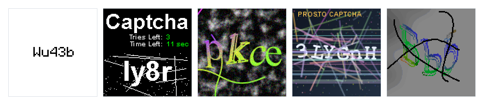
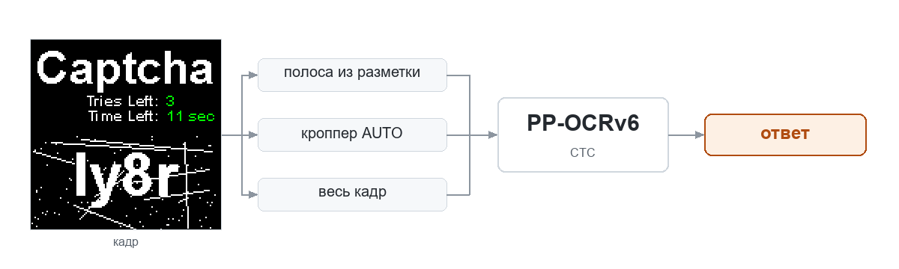

# CaptchaOCR



*Пять капч из датасета — картинки генераторов, а не скриншоты игры.*

[](https://huggingface.co/datasets/Titlehhhh/captchaocr-dataset)
[](https://huggingface.co/datasets/Titlehhhh/captchaocr-dataset)
[](https://huggingface.co/Titlehhhh/captchaocr-ppocrv6)


210 000 картинок с капчами антибот-плагинов для Minecraft-серверов и модель PP-OCRv6, которая читает код с картинки.

Генераторы на Java перерисовывают капчи 13 плагинов; на диске 21 тип, по 10 000 картинок.

Модель дообучена на этих картинках. Как мерили точность — в `reports/`.

[Установка](#установка) · [Использование](#использование) · [Что скачать](#что-скачать) · [Результаты](#результаты) · [Что работает](#что-работает-и-что-нет) · [Карта](#карта-репозитория)

## Установка

```powershell
git clone https://github.com/Titlehhhh/CaptchaOCR
cd CaptchaOCR
python -m venv .venv
.venv\Scripts\pip install -r requirements.txt
```

Нужен Python 3.13 и пакеты из `requirements.txt` (`transformers` 5.19, `torch`); GPU не обязателен. Датасет занимает около 1,9 ГиБ, веса модели — 77 МБ. Генераторам нужен JDK 21.

## Использование

```python
import torch
from PIL import Image
from transformers import PPOCRV6SmallRecForTextRecognition
from transformers import PPOCRV6SmallRecImageProcessor

REPO = "Titlehhhh/captchaocr-ppocrv6"
model = PPOCRV6SmallRecForTextRecognition.from_pretrained(REPO).eval()
proc = PPOCRV6SmallRecImageProcessor.from_pretrained(REPO)
inputs = proc(images=[Image.open("band.png").convert("RGB")], return_tensors="pt")
with torch.no_grad():
    logits = model(**inputs)
print(proc.post_process_text_recognition(logits))
```

`band.png` — вырезанная строка с кодом. Модель читает строку, а не картинку целиком.

```python
import io
import pyarrow.parquet as pq
from PIL import Image
row = pq.read_table("data").slice(0, 1).to_pylist()[0]
image = Image.open(io.BytesIO(row["image"]))
x, y, w, h = row["roi"]
band = image.crop((x, y, x + w, y + h))
```

`image` — байты PNG, `answer` — код, который вводит игрок, `text` — что нарисовано (у трёх типов отличается от `answer`), `roi` — координаты строки с кодом. У восьми типов `roi` пуст — там модель читает картинку целиком.

## Что скачать

- **Датасет** — [Titlehhhh/captchaocr-dataset](https://huggingface.co/datasets/Titlehhhh/captchaocr-dataset): 20 типов, 200 000 записей в 9 файлах Parquet; 21-й тип (`out_ru/LimboFilter/digits`) добавлен после публикации. Запись — картинка, код, который вводит игрок, и координаты строки с кодом.
- **Модель** — [Titlehhhh/captchaocr-ppocrv6](https://huggingface.co/Titlehhhh/captchaocr-ppocrv6): `universal_v1`. Точность мерили на уже вырезанных строках с кодом. Медиана по 18 типам (21 тип на диске минус три с числом прописью; они в замер не вошли) — 88,75 % полностью прочитанных строк; по всем 11 400 картинкам — 77,97 %.
- **Демо** — `.venv\Scripts\python webapp\app.py`, затем <http://127.0.0.1:8765/>. Работает офлайн, без сети.

```python
from huggingface_hub import snapshot_download
snapshot_download("Titlehhhh/captchaocr-dataset", repo_type="dataset", local_dir="data")
```

## Результаты



Здесь замеряется вся цепочка — от картинки до ответа, а не только модель на уже вырезанной строке. 840 случайных картинок, по 40 с каждого типа.

| строка вырезана по разметке | строка выбрана автоматически | вся картинка |
|---:|---:|---:|
| 66,79 % | **62,26 %** | 43,57 % |

В первой колонке строку вырезали по координатам из разметки — это верхняя граница. Во второй строку находит детектор из `webapp/`. В третьей модель читает картинку целиком. У трёх типов точность нулевая, даже когда строку вырезали идеально: `GalleryCaptcha/ru-numberword`, `GalleryCaptcha/ru-numberword-caption`, `LimboFilter/map`.

## Что работает и что нет

- Из двадцати опубликованных типов шесть перенесены из кода плагинов без изменений, десять переписаны с нуля, четыре восстановлены по скриншотам.
- Выбор строки автоматически точнее, чем чтение всей картинки.
- Генераторы повторяют капчи вместе с ошибками плагинов.
- Модель читает латиницу, цифры и часть кириллицы.

- Типы с числом прописью OCR не берёт — нужен отдельный шаг.
- Собственная CRNN на незнакомых плагинах распознаёт меньше половины строк.
- TrOCR хуже и медленнее.
- Случайность в генераторах не зафиксирована: пересборка даст другой набор картинок.

## Карта репозитория

| путь | что внутри |
|---|---|
| `dataset/generator/`, `dataset/generator_ru/` | генераторы капч на Java |
| `dataset/out/` | картинки и разметка; в git их нет |
| `dataset/out_ru/` | капчи русских плагинов и веб-капча |
| `train/` | CRNN+CTC с нуля, дообучение PP-OCRv6 и TrOCR |
| `webapp/` | офлайн-демо и детектор строки |
| `reports/`, `docs/` | замеры, как начать, формат данных |

## Где ещё почитать

- [Все измеренные числа](reports/HTML/index.html)
- [Как начать](docs/ONBOARDING.md)
- [Как обучать](docs/HOW_TO_TRAIN.md)
- [Формат датасета](docs/DATASET_FORMAT.md)
- [Плагины](docs/PLUGINS.md)

Статьи: [CRNN](https://arxiv.org/abs/1507.05717) · [PP-OCRv6](https://arxiv.org/abs/2606.13108) · [SVTRv2](https://arxiv.org/abs/2411.15858).

## Участие

Issues и PR принимаются. Новый тип капчи — один java-файл в `dataset/generator/dev/captcha/gens/`. Принести замер чужой модели тоже будет полезно.

## Лицензия

Код — MIT ([`LICENSE`](LICENSE)). Веса модели — Apache-2.0, как у PP-OCRv6. Картинки — не MIT: у каждой лицензия своего плагина, у части плагинов коммерческое использование запрещено. Разбор — в [`docs/LICENSES.md`](docs/LICENSES.md).
